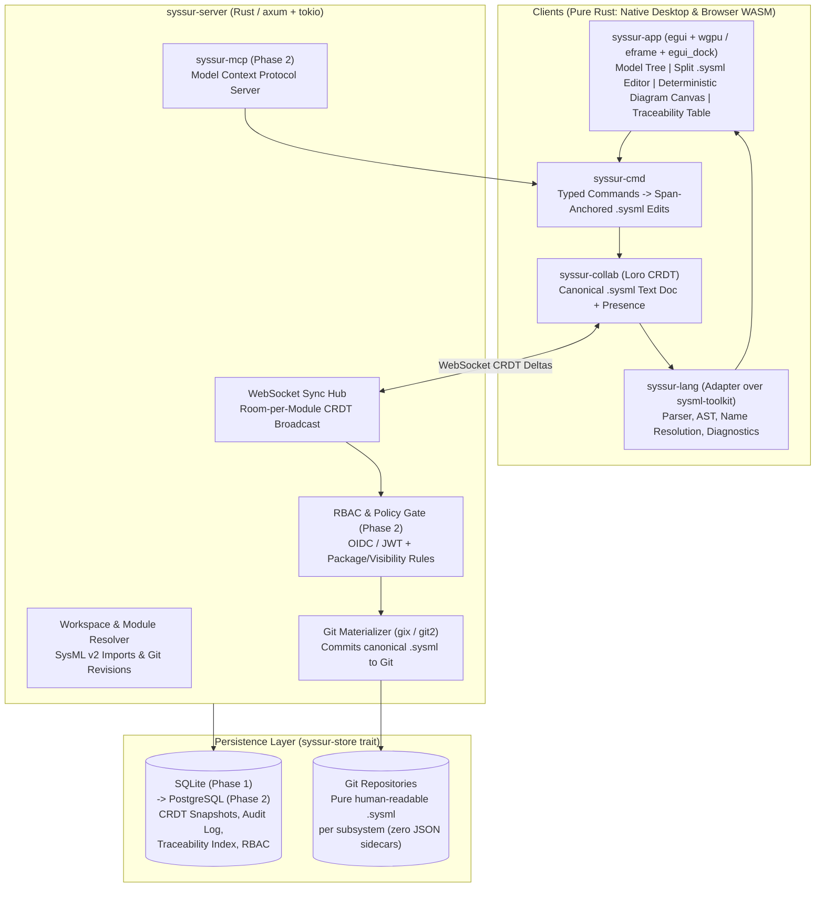

# Syssur — Architecture & Implementation Plan

## Goal Description

**Syssur** is an open, multi-platform (Native Desktop + Browser/WASM) **Model-Based Systems Engineering (MBSE)** platform written in **Rust**. It enables engineering organizations to collaboratively design, compose, version, and verify complex systems using **SysML v2** as a human- and LLM-readable Everything-as-Code foundation.

### Core Architectural Decisions (Aligned via Design Interview)

| Dimension | Decision | Rationale |
| :--- | :--- | :--- |
| **Canonical Source of Truth** | **Hybrid:** Central event-sourced/CRDT DB for live multi-user editing & RBAC, automatically materialized to canonical `.sysml` text files in Git per module/project. | Combines Figma-like real-time multiplayer and enterprise access control with Everything-as-Code, clean Git diffs, and LLM readability. |
| **Modeling Language & Engine** | **Native SysML v2** via [`Open-MBEE/sysml-toolkit`](https://github.com/Open-MBEE/sysml-toolkit) (Apache-2.0, pure Rust + WASM) wrapped behind a `syssur-lang` adapter crate. | Eliminates months of parser/metamodel work, guarantees 100% SysML v2 interoperability, and provides built-in name resolution, formatting, and expression/unit evaluation. |
| **Concurrency Model** | **CRDT-based live sync** (`loro` in pure Rust + WASM) on the canonical `.sysml` text per module, gated by server-side RBAC and snapshotted to Git (zero sidecar layout files). | Allows simultaneous graphical and textual editing without lock contention, merge conflicts, or diagram drift. |
| **Composability & Process** | **Native SysML v2 Composition & Views:** Compose systems directly via SysML v2's unified Definition vs. Usage model (`part def`/`port def`/`interface def` vs. `part`/`port`/`interface`/`connect`), packages, `import`, subsetting (`:>`), redefinition (`:>>`), and port conjugation (`~`) across Git-backed modules—no manual `.toml`/lockfile overhead. Separate the **Definition Graph** from the **Contextual Instance Tree** (`InstancePath`), scope diagrams via `view`/`viewpoint` `expose` filters, and enforce team boundaries via package-level RBAC. | Keeps authoring frictionless and 100% idiomatic SysML v2 while cleanly scaling to deeply nested multi-team systems. |
| **GUI & Platform** | **Pure Rust `egui` + `wgpu`** (`eframe` + `egui_dock`), combining VS Code/Cameo-style dockable panels, [SolidCraft](https://github.com/tangency-labs/solidcraft)-style top ribbons & bottom history line, [Eclipse SysON](https://github.com/eclipse-syson/syson) / [sysml_view_editor](https://github.com/Open-MBEE/sysml_view_editor) views, and `egui::Painter` with `rstar` R-tree frustum culling + LOD rendering. | Single Rust codebase compiles natively to Linux/macOS/Windows and to Browser WASM (WebGPU/WebGL2), scaling smoothly to large system diagrams. |
| **Persistence & Auth** | **SQLite first** (zero-config dev/test & single-binary) behind a `syssur-store` trait architected for **PostgreSQL** in production + Git repo backend + OIDC/RBAC in Phase 2. | Fast local iteration without sacrificing enterprise scalability or fine-grained access control. |
| **Command Layer & AI (MCP)** | **Unified Command Architecture** (`syssur-cmd`, SolidCraft pattern): every UI action, CLI command, and Phase 2 MCP tool executes the same typed commands. | Guarantees parity between GUI, CLI, and AI agents with full auditability and undo/redo. |

---

## System Architecture



---

## Key Architectural Mechanics

### 1. Everything-as-Code + Live Graphical Editing (Pure `.sysml`, Zero Sidecar Files)
To eliminate "diagram drift" and keep `.sysml` text as the **sole**, clean, LLM-readable ground truth:
- **Semantic Model = `.sysml` Text CRDT:** All graphical actions (e.g., *Add Part*, *Create Port*, *Connect Ports*, *Add Satisfy Requirement*, *Rename*) compile into a `SyssurCommand`, which uses `sysml-toolkit`'s span-anchored AST edits to mutate the Loro Text CRDT cleanly while preserving comments and formatting.
- **Stable Identity (`ElementId`):** Elements are identified by their SysML v2 **Qualified Name** (e.g., `Vehicle::Powertrain::engine`), keeping `.sysml` files completely free of synthetic UUID comments. Atomic rename commands in `syssur-cmd` update definitions and all references together.
- **Zero Sidecar Layout Files (100% Deterministic Auto-Layout):** There is **no** `.syssur-view.json` file, no layout CRDT, and no persisted manual coordinates. Every diagram layout is computed deterministically on the fly from the AST + `InstancePath` (see Section 3 below), so Git repositories contain **only** pure `.sysml` files.
- **Git Snapshots:** On explicit "Commit / Publish Version" (or scheduled autosave), the server materializes the current CRDT frontier into the module's Git repository as clean `.sysml` files.

### 2. Native SysML v2 Composability & Large-System Architectural Rules
Rather than forcing engineers to maintain external `.toml` manifests and lockfiles, Syssur composes systems natively through **SysML v2's unified Definition vs. Usage model**: standalone subsystems defined in separate packages (`part def`, `port def`, `interface def`), instantiated as contextual usages (`part`, `port`, `interface`, `connect`), specialized via **subsetting (`:>`)** and **redefinition (`:>>`)**, and wired across boundaries with **port conjugation (`~`)**, backed by Git revisions and package-level RBAC. To handle deeply nested composed systems cleanly, Syssur enforces **three core architectural rules**:

1. **Separate "Definition Graph" from "Contextual Instance Tree" (Occurrence Tree):**
   - In the AST (`sysml-toolkit`), a parent part (e.g., `Powertrain`) only owns its direct `part engine : Engine` usage—it does **not** duplicate `Engine`'s internal sub-parts (`pistons`, `valves`) in the syntax tree.
   - When the user expands `Powertrain` in a diagram or tree view, Syssur dynamically resolves an **`InstancePath`** (`Vec<ElementId>`, e.g., `[VehicleId, PowertrainId, EngineId, PistonId]`), handling both **multiplicity expansion** (e.g., `part wheel : Wheel[4]`) and **subsetting roles** (e.g., `part frontLeftWheel :> wheel`) so subsetted usages appear as distinct, linked roles rather than duplicate unlinked parts.
   - Keying computed diagram node geometry, selection state, expand/collapse UI state, and evaluation/simulation state by `InstancePath` instead of raw `ElementId` guarantees that when `Wheel` is instantiated 4 times, expanding, selecting, or laying out `frontLeftWheel` never collides with `rearRightWheel`.
2. **Use SysML v2 `view` & `viewpoint` Filters for Diagram Scope:**
   - Never render the entire composed hierarchy at once.
   - Support native SysML v2 `view` / `viewpoint` definitions (e.g., `view StructuralBreakdown`, `view PowerInterfaceView`) that query the semantic arena by exposure (e.g., `expose Powertrain::**`) and filter by relationship kind (`connection`, `interface`, `flow`, `specialization`, `satisfy`, etc.).
3. **Visualizing Subsetting (`:>`), Redefinition (`:>>`) & Conjugation (`~`):**
   - **Inherited, Subsetted & Redefined Compartments:** Render inherited features from base definitions in muted/italic text with `^`, `:>`, or `:>>` badges so engineers immediately distinguish inherited features, subsetted roles (`part frontLeftWheel :> wheel`), and overridden/redefined subsystems (`part :>> engine : ElectricMotor`).
   - **Port Direction & Compatibility Indicators (`connect` & `interface`):** Automatically mirror port glyphs (inward vs. outward arrows) whenever a port usage carries the `isConjugated` flag (`~`), support both ad-hoc `connect` usages and typed `interface : InterfaceDef` usages, and highlight type mismatches live when dragging a connection between incompatible `PortDefinition`s.

- **Cross-Team Traceability & Verification:** The `syssur-store` traceability index extracts `satisfy`, `verify`, `allocate`, and `connection` edges across workspace packages and pinned Git revisions so teams can run impact analysis when an upstream subsystem updates.

### 3. Graphical Editor Architecture (`egui_dock`, SolidCraft Chrome, SysON Views & Scalable Canvas)
- **Docking & Workspace Layout (`egui_dock`):** Flexible, VS Code / Cameo-style dockable split panes and tabbed views so engineers can arrange explorers, diagrams, `.sysml` code, inspectors, and traceability tables freely.
- **SolidCraft-Inspired Chrome:**
  - **Top Ribbon:** Context-aware tool ribbons for modeling actions, view switching, layout controls, and version/sync status.
  - **Bottom History / Command Line:** Persistent command/history bar showing recent `syssur-cmd` operations, undo/redo timeline, quick keyboard-driven command input, and live sync/diagnostic status.
- **SysON-Inspired Synchronized Views:** Following Eclipse SysON's SysML v2 view model (and `sysml_view_editor`'s source-defined views), `syssur-app` renders synchronized projections of the same underlying AST:
  1. **Model Explorer Tree:** Hierarchical package/part/port/requirement browser with diagnostics badges.
  2. **Split `.sysml` Code Editor:** Live text editor bound directly to the Loro Text CRDT with inline `sysml-toolkit` diagnostics.
  3. **General View (Structural Canvas):** Pan/zoom node graph showing packages, part definitions/usages, specialization, and composition arrows, driven by deterministic auto-layout.
  4. **Interconnection View:** Internal part decomposition with pinned boundary ports and typed interface connections (`connect` and `interface`).
  5. **Requirements & Traceability Table:** Tabular editor showing requirements, `satisfy` / `verify` links, and status.
- **Deterministic Auto-Layout & Orthogonal Routing (`syssur-layout`):**
  - **Dagre Layout Engine (`dagre` crate):** Computes hierarchical compound node/container bounding boxes directly from the filtered view graph without persisted manual coordinates.
  - **Canonical AST-Span Pre-Sorter:** Before invoking `dagre`, sort all input nodes, compound parents, and edges by their **SysML AST declaration span (byte offset in the `.sysml` file)**. This guarantees **100% bit-for-bit identical layouts** across Windows, macOS, Linux, and WASM every single time.
  - **Dedicated Orthogonal Router:** Discard Dagre's spline polylines; keep Dagre's node/container bounding boxes, pin ports cleanly to container borders, and run a dedicated **orthogonal A\* / channel router** between ports so wires run cleanly horizontally and vertically around blocks.
- **Large Diagram Scaling (`egui::Painter` + `rstar` + LOD):**
  - Custom 2D canvas rendered directly with **`egui::Painter`** for minimal overhead on Desktop and WASM.
  - **Frustum Culling via `rstar` R-tree:** All diagram nodes, ports, and edge bounding boxes are indexed in an `rstar` R-tree so each frame queries and paints only elements intersecting the current viewport.
  - **Level-of-Detail (LOD) Rendering:** Zoom-tiered rendering (e.g., *macro zoom*: simplified silhouettes & package clusters; *mid zoom*: block headers & primary edges; *micro zoom*: full compartments, port labels, types, and stereotypes) to maintain smooth 60+ FPS even on thousands of elements.

---

## User Review Required

> [!IMPORTANT]
> **Workspace Location:** Before executing Phase 1 scaffolding, please confirm the absolute path of the new `syssur` folder you created (or open it as the active workspace in Antigravity) so we create files in the right repository.

> [!NOTE]
> **`sysml-toolkit` Dependency Strategy:** `Open-MBEE/sysml-toolkit` is Apache-2.0 and actively evolving. We will pin it to a specific Git commit/tag in `Cargo.toml` and isolate all calls inside `crates/syssur-lang` so upstream API changes never ripple into the UI, CRDT, or server crates.

> [!WARNING]
> **WASM Threading & Z3:** Full Z3 constraint solving in `sysml-toolkit` is native-only (C++ FFI). For Browser/WASM builds, `syssur-lang` will enable pure-Rust parsing, name resolution, formatting, and interval evaluation via Cargo feature flags, delegating heavy Z3/SMT verification to `syssur-server` when needed.

---

## Proposed Rust Workspace Structure

```text
syssur/
├── Cargo.toml                  # Rust workspace manifest
├── crates/
│   ├── syssur-model/           # [NEW] Core domain types: ElementId (QualifiedName), InstancePath (occurrence tree), ViewFilter (expose/relationship), TraceabilityGraph
│   ├── syssur-lang/            # [NEW] Adapter wrapping Open-MBEE/sysml-toolkit (parse, resolve, diagnostics, span-edit, format)
│   ├── syssur-layout/          # [NEW] Deterministic Dagre layout (canonical AST-span pre-sorter) + port border pinning + orthogonal A*/channel router
│   ├── syssur-cmd/             # [NEW] Unified command engine (AddPart, AddPort, Connect, CreateInterface, SetRequirement, Rename) + Undo/Redo
│   ├── syssur-collab/          # [NEW] Loro CRDT wrapper (canonical .sysml text doc, delta encoding, awareness/cursors)
│   ├── syssur-store/           # [NEW] Storage trait + SQLite implementation (sqlx) + Git sync (gix/git2); Postgres-ready schema
│   ├── syssur-server/          # [NEW] Axum HTTP/WebSocket server (CRDT rooms, workspace/module resolution, Git snapshots)
│   ├── syssur-app/             # [NEW] Pure Rust egui + wgpu (eframe + egui_dock + rstar) app compiling to Desktop & WASM (trunk)
│   ├── syssur-mcp/             # [Phase 2] Model Context Protocol server over syssur-cmd & syssur-store
│   └── syssur-cli/             # [Phase 2/3] Headless CLI for CI validation, SysML v2 / RDF export, and snapshot verification
└── examples/
    └── rover-system/           # [NEW] Sample composed SysML v2 system (vehicle -> powertrain/chassis/wheels with :>> & ~ ports) for tests & demos
```

---

## Phased Execution Roadmap

### Phase 1 — Vertical Slice MVP (Target First Milestone)
1. **Workspace, Occurrence Tree & Language Core (`syssur-model`, `syssur-lang`)**
   - Initialize Cargo workspace with pinned `sysml-toolkit` crates (WASM-compatible feature set).
   - Resolve multi-file SysML v2 workspaces and `import`s natively across project directories/Git submodules.
   - Build the **Definition Graph** vs. dynamic **Contextual Instance Tree** (`InstancePath = Vec<ElementId>`, supporting multiplicity `[n]` and subsetting `:>` roles), plus a **`view`/`viewpoint` query engine** evaluating `expose` clauses and relationship-kind filters (`connection`, `interface`, `flow`, `specialization`, `satisfy`, `verify`) and tracking inherited, subsetted (`:>`), and redefined (`:>>`) features as well as conjugated (`~`) ports.
2. **Deterministic Layout, Command & Collaboration Engine (`syssur-layout`, `syssur-cmd`, `syssur-collab`)**
   - Implement `syssur-layout` with a canonical AST-span pre-sorter feeding the `dagre` crate for compound node bounding boxes, border port pinning, and an orthogonal A\* / channel wire router—guaranteed bit-for-bit identical across Native and WASM.
   - Implement core typed commands (`CreatePackage`, `CreatePartDef`, `CreatePartUsage`, `CreatePort`, `CreateConnection`, `CreateInterface`, `CreateRequirement`, `LinkSatisfy`, `RenameElement`) translating cleanly to span-anchored `.sysml` text edits.
   - Wrap `loro` for canonical `.sysml` text CRDT sync with binary delta serialization for both native and `wasm32-unknown-unknown` (no sidecar layout CRDT needed).
3. **Persistence & Live Sync Server (`syssur-store`, `syssur-server`)**
   - Define async `ProjectStore` trait with SQLite (`sqlx`) implementation (projects, modules, CRDT snapshots/updates, indexed traceability edges) using ANSI-compatible SQL migrations ready for PostgreSQL.
   - Implement Git snapshot commit/load per project/module.
   - Build `axum` WebSocket server broadcasting Loro CRDT deltas and user presence/cursors per module room.
4. **Desktop + Browser/WASM Graphical Editor (`syssur-app`)**
   - Build `eframe` (`egui` + `wgpu`) shell with **`egui_dock`** (VS Code / Cameo-style dockable panels), **SolidCraft-style top ribbons & bottom command/history line**, compiling natively and to WASM via `trunk`.
   - Implement the scalable **`egui::Painter` diagram canvas** driven by `syssur-layout` (deterministic Dagre + orthogonal port router), backed by an **`rstar` R-tree** for viewport frustum culling and **Level-of-Detail (LOD)** rendering, keyed by `InstancePath` and scoped by SysML v2 `view`/`viewpoint` filters.
   - Render **inherited, subsetted (`:>`) & redefined (`:>>`) compartments** (muted/italic with `^`, `:>`, `:>>` badges) and **conjugated (`~`) port direction glyphs** with live connection type-compatibility highlighting.
   - Implement 4 synchronized SysON-inspired panels: **Model Tree** (Definition + expandable Instance Tree), **Split `.sysml` Text Editor**, **Interactive Diagram Canvas** (General View + Interconnection View with pan/zoom, port snapping, deterministic layout), and **Requirements/Traceability Table**.
   - Support both **Local/Offline mode** and **Connected Live-Sync mode** against `syssur-server`.

### Phase 2 — Enterprise Access Control (RBAC), PostgreSQL & MCP Server
1. **Access Management (`syssur-auth`, `syssur-store` Postgres)**
   - Add PostgreSQL backend implementation of `ProjectStore`.
   - Implement OIDC/JWT authentication + team/role-based policies (`Viewer`, `Editor`, `Verifier`, `Admin`) enforced at the package and visibility boundary (`black-box` vs. `white-box`) in WebSocket rooms and package resolution.
   - Optional sync with external Git forge permissions (GitHub/GitLab/Gitea).
2. **MCP Server (`syssur-mcp`)**
   - Expose read tools (`list_packages`, `get_sysml_source`, `query_traceability`, `get_diagnostics`, `impact_analysis`) and write tools (`apply_command`, `propose_sysml_edit`) backed by `syssur-cmd` and RBAC.
   - Enables AI agents to inspect, author, and verify composed system models safely via Everything-as-Code.
3. **Interoperability & Exports**
   - Standard SysML v2 API JSON / `.sysml` bundle export and optional **RDF/Turtle / JSON-LD** semantic projection for external graph/OSLC tooling.

### Phase 3 — Extended SysML v2 Views & CI Verification
- Additional SysON-style views: **Action Flow View**, **State Transition View**, and **Verification Dashboard**.
- Expression/unit/constraint evaluation panels powered by `sysml-toolkit`.
- Headless `syssur-cli` for CI/CD pipelines (lint, check cross-package traceability coverage, verify constraints).

---

## Verification Plan

### Automated Tests (Phase 1)
- **Core & Language Unit Tests:** `cargo test --workspace` covering multi-file SysML v2 `import` resolution, `InstancePath` occurrence tree expansion (verifying independent computed geometry & UI state for multiple usages of the same definition), deterministic `syssur-layout` snapshots (canonical AST-span pre-sort + orthogonal routing bit-for-bit identical across runs), `view`/`viewpoint` `expose` filtering, `:>` / `:>>` / `~` metadata, and round-trip command-to-text mutations (`CreatePart`, `ConnectPort`, `RenameElement`, etc. preserve formatting and re-parse with zero errors).
- **CRDT Convergence Integration Tests:** Automated multi-client test spawning two simulated `syssur-collab` clients editing the same `.sysml` module concurrently (one via graphical commands, one via raw text edits) through `syssur-server`, asserting identical final text, valid SysML v2 AST, and clean Git snapshot commits.
- **Cross-Platform Build Checks:**
  - Native: `cargo build --workspace`
  - WASM: `cargo check -p syssur-app --target wasm32-unknown-unknown` and `trunk build`

### Manual Verification (Phase 1)
1. Start `syssur-server` locally (SQLite mode) and open the `examples/rover-system` multi-package project.
2. Open **two clients simultaneously**—one Native Desktop (`cargo run -p syssur-app`) and one Browser/WASM tab (`trunk serve`).
3. Add a part and port graphically in the Desktop app and verify it appears live in the Browser's diagram and `.sysml` text editor; edit a requirement in the Browser text editor and verify it updates live in the Desktop traceability table.
4. Trigger a **Commit Snapshot** and inspect the generated Git repository to confirm clean, human-readable `.sysml` diffs.
